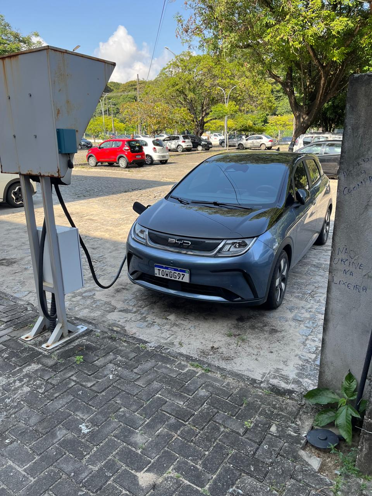
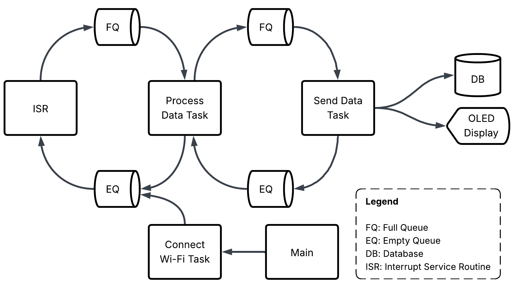
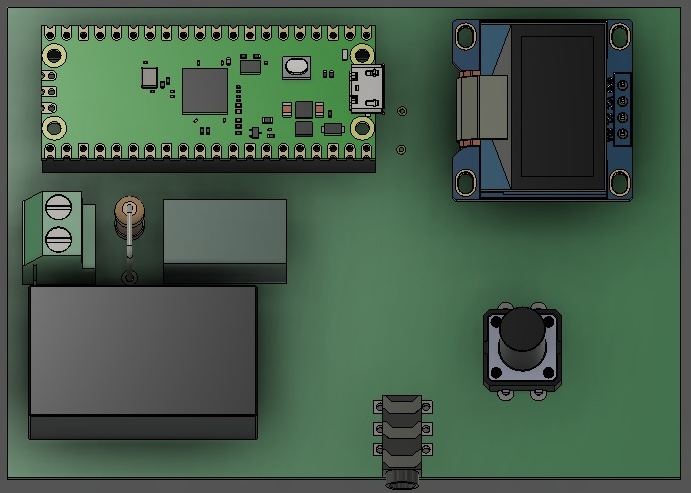
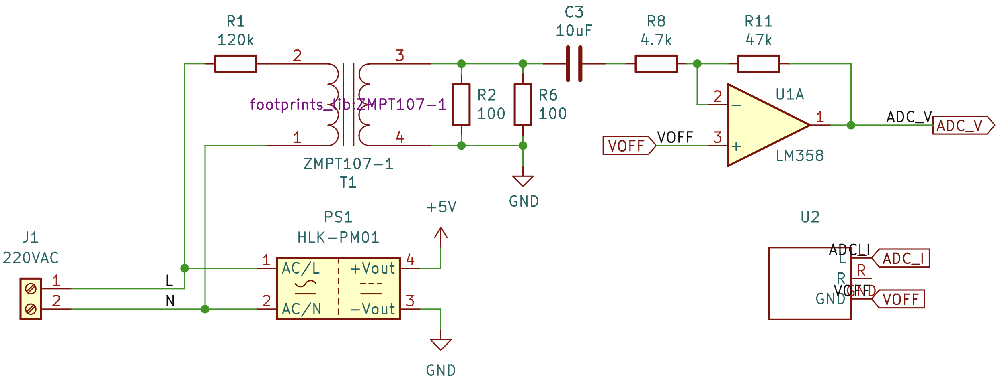
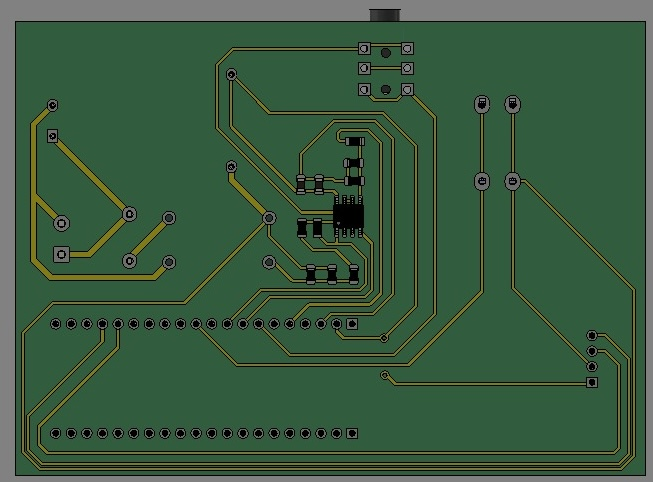
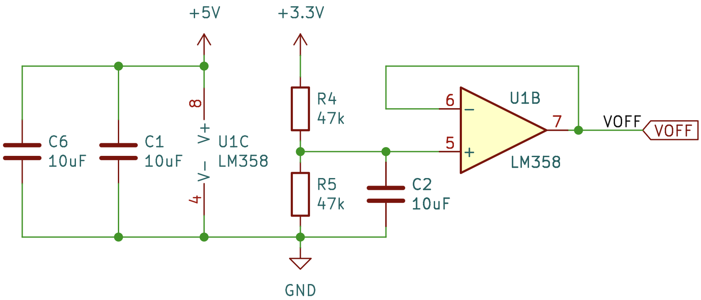
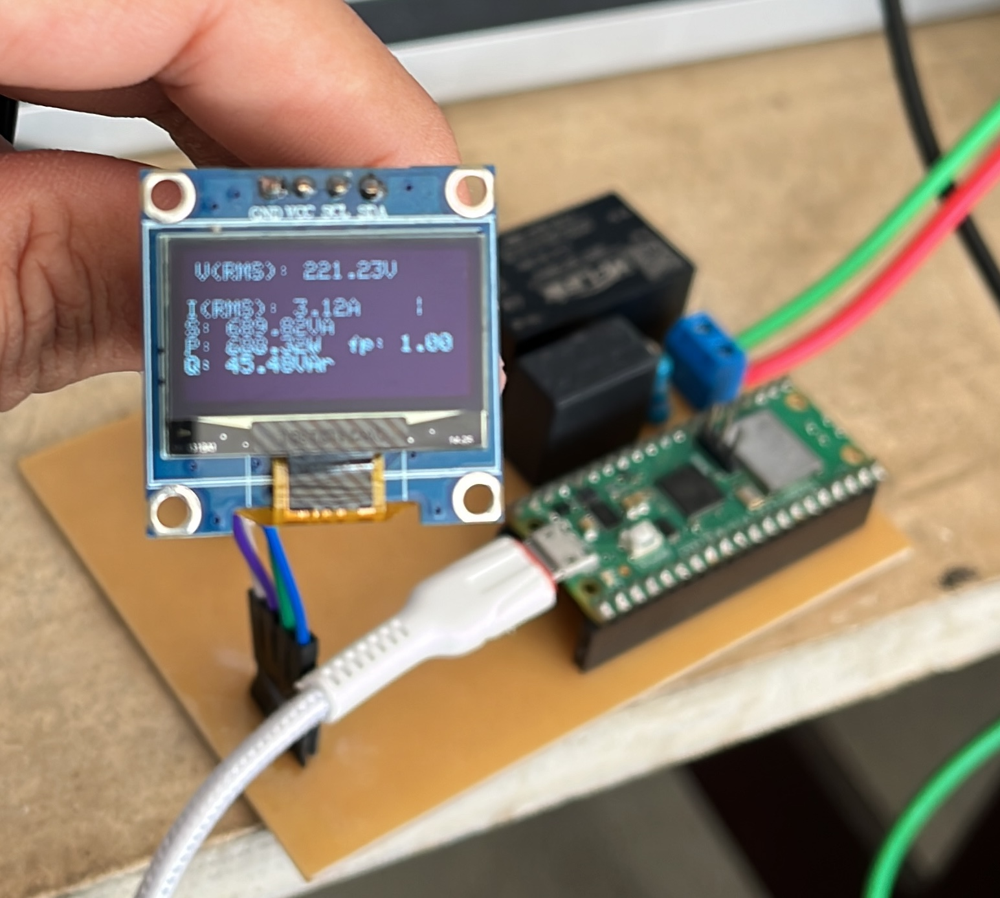
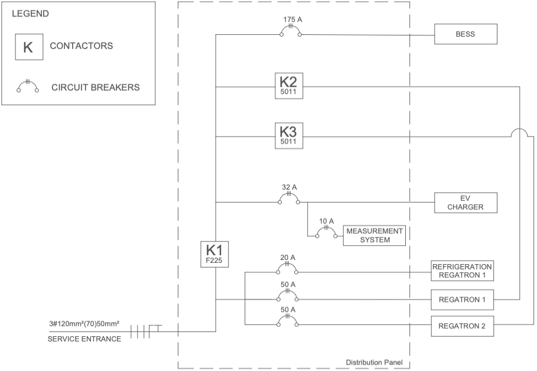
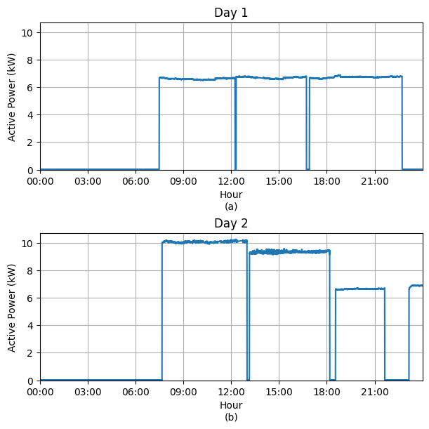
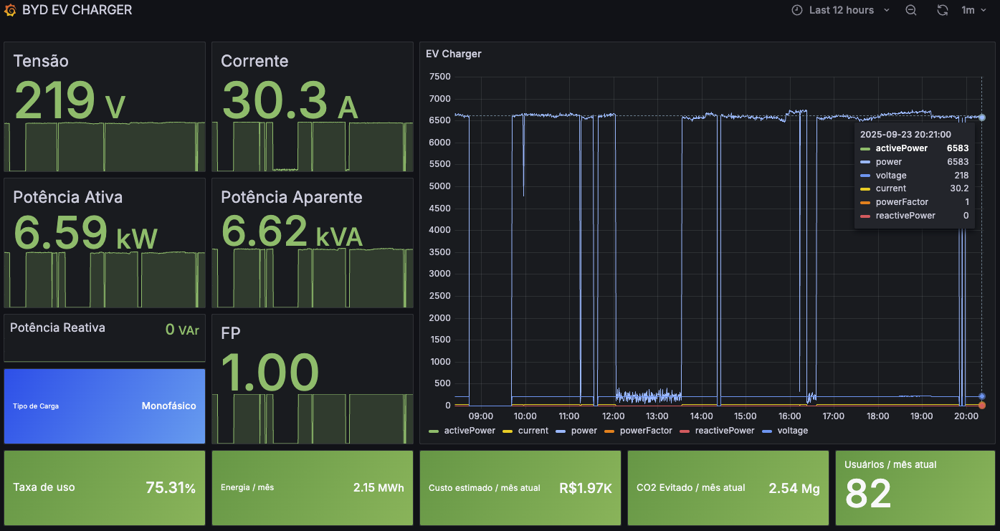

# Raspberry Pi Pico Energy Analyzer

A low-cost IoT system that measures voltage and current in real time and computes active, reactive and apparent power and power factor. I built it to monitor **electric vehicle chargers** and tested it on a commercial EV charger in single-phase and three-phase operation.

This is the code behind my undergraduate thesis in Electrical Engineering at UFPB. The work was later published as a paper:

> 📄 **[Real-Time Power Measurement System for Electric Vehicle Chargers](https://ieeexplore.ieee.org/document/11368787)** (IEEE)
> Patrick Diego Alves da Silva, Camila Seibel Gehrke, Lucas Vinicius Hartmann. Department of Electrical Engineering, Federal University of Paraíba (UFPB)
>
> 🎓 **[Undergraduate thesis (PDF, Portuguese)](docs/thesis.pdf)**: *Sistema de medição de energia em tempo real para carregadores de veículos elétricos*, UFPB, 2025

<p align="center">
  
</p>

## How it works

- **Sensing:** a ZMPT107-1 voltage sensor and an SCT-013 current clamp take measurements without touching the power circuit.
- **Sampling:** the RP2040 ADC reads both channels in round-robin at 24 kS/s. An interrupt routine fills buffers of 400 samples.
- **Processing:** a FreeRTOS task computes RMS voltage and current, active, reactive and apparent power, and power factor.
- **Output:** results are shown on a 128×64 OLED display and sent over Wi-Fi and HTTPS (lwIP + mbedTLS) to InfluxDB, a time series database, with a Grafana dashboard on top.

### Firmware architecture

Buffers move between the ISR and the tasks through pairs of FreeRTOS queues: one queue holds full buffers and the other holds empty ones. Nothing is allocated at runtime, and the interrupt never waits on a task.

<p align="center">
  
</p>

## Hardware

| PCB (3D view) | Circuit |
|---|---|
|  |  |
|  |  |

<p align="center">
  
</p>

## Results

I installed the meter in the distribution panel that feeds a commercial EV charger and collected data over several days.

<p align="center">
  
</p>

- **Day 1:** three single-phase charging sessions at about **6.7 kW**, **99.7 kWh** in total.
- **Day 2:** mixed operation. One vehicle charged in three-phase mode at about **10.2 kW** (≈15.4 A per phase, ≈380 V line voltage). The day totaled **126.4 kWh**.

<p align="center">
  
  
</p>

## Stack

C/C++ · Raspberry Pi Pico W (RP2040) · FreeRTOS · Pico SDK · lwIP · mbedTLS · InfluxDB 2 · Grafana · Docker Compose · Cloudflare Tunnel

## Running it

### 1. Firmware

Install the toolchain, the [pico-sdk](https://github.com/raspberrypi/pico-sdk) and the [FreeRTOS kernel](https://github.com/FreeRTOS/FreeRTOS-Kernel):

```sh
sudo apt install -y cmake git gcc-arm-none-eabi libnewlib-arm-none-eabi libstdc++-arm-none-eabi-newlib
sudo mkdir -p /opt/pico && cd /opt/pico
sudo git clone --depth 1 https://github.com/FreeRTOS/FreeRTOS-Kernel
sudo git clone --depth 1 https://github.com/raspberrypi/pico-sdk
cd pico-sdk && sudo git submodule update --init --depth 1

export PICO_BOARD=pico_w
export PICO_SDK_PATH=/opt/pico/pico-sdk
export FREERTOS_KERNEL_PATH=/opt/pico/FreeRTOS-Kernel
```

Fill in your Wi-Fi and InfluxDB settings in [`include/config.h`](include/config.h), replacing every value marked `change-me`. Then build:

```sh
mkdir build && cd build
cmake .. && make -j
```

To flash `build/main.uf2`, hold BOOTSEL while you plug in the Pico. On Linux, [`helper.sh`](helper.sh) copies the UF2 automatically and opens the serial console.

For calibration, `ADC_TEST_MODE` in `config.h` enables single-channel test modes and `LOG_BUFFERS` logs the raw buffers.

### 2. Database and dashboard

```sh
docker compose up -d
```

This starts InfluxDB (`:8086`), Grafana (`:3000`) and an optional Cloudflare Tunnel that exposes InfluxDB to the Pico over HTTPS. Replace every `change-me` in [`docker-compose.yaml`](docker-compose.yaml) before you run it, then import [`grafana-dashboard.json`](grafana-dashboard.json) into Grafana.

## Credits

- Advisor: Prof. Dr. Camila Seibel Gehrke (UFPB).
- The FreeRTOS + Pico W starting point comes from [Lucas Hartmann's template](https://gitlab.com/lucas.hartmann/raspberry_pico_freertos).
- The OLED driver is [SSD1306_OLED_PICO](https://github.com/gavinlyonsrepo/SSD1306_OLED_PICO) by Gavin Lyons (GPL-3.0). It is included in `SSD1306_OLED_PICO/` together with its license.
